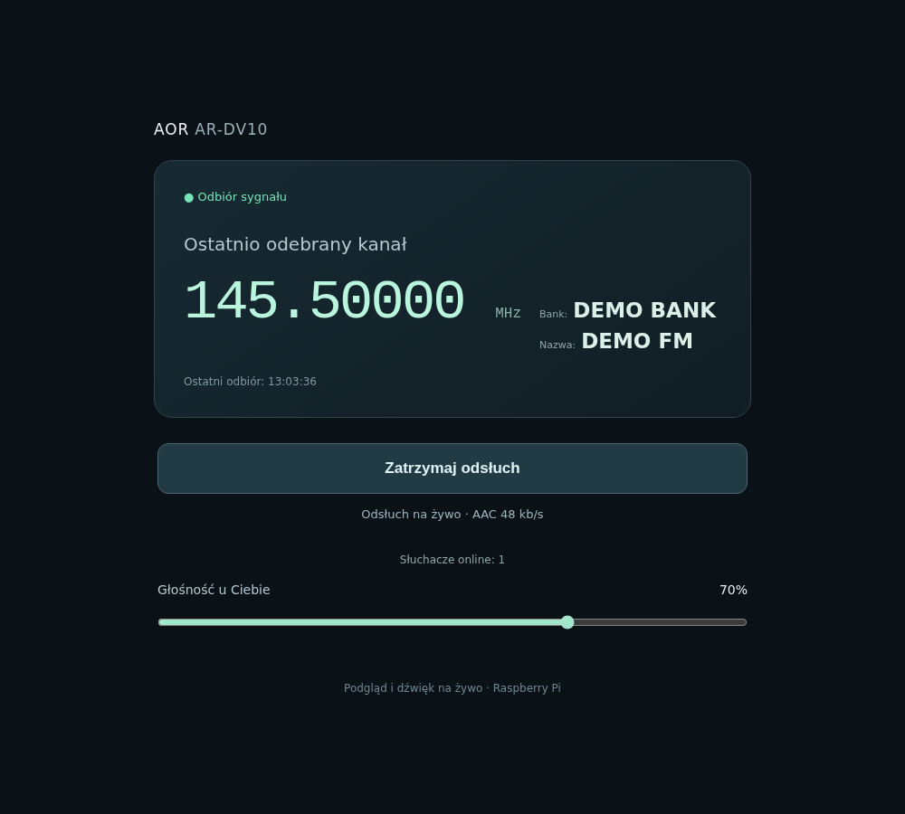
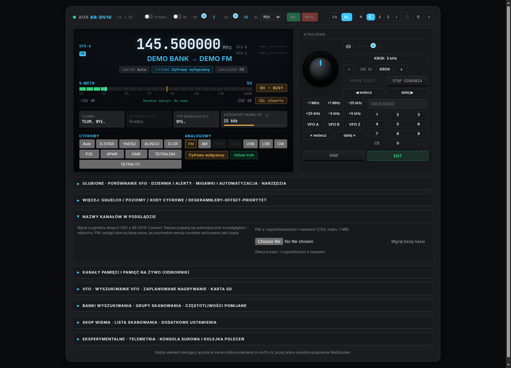

# AOR DV10 Raspberry Suite

[Polski](README.pl.md) · English

A Raspberry Pi web interface for the AOR AR-DV10 receiver, with a full control panel and a separate read-only listening page. Stream live AAC audio, display channel names from an AR-DV10 Connect CSV export, and keep the last received channel visible while the radio resumes scanning.

## Credits

This project was built using **[roxio/AOR-AR-DV10-Suite](https://github.com/roxio/AOR-AR-DV10-Suite)** as its foundation. Credit for the original receiver-control library and web panel belongs to the upstream author and contributors. This version adds the Raspberry Pi listening page, audio streaming, channel-name integration and browser-based CSV uploads. The repository uses the existing GPL-3.0 license in [LICENSE](LICENSE). The upstream MIT license and copyright notice are retained in [LICENSE.upstream-MIT](LICENSE.upstream-MIT).

Original documentation: [English](docs/UPSTREAM_README.md) · [Polish](docs/UPSTREAM_README.pl.md).

## Features

- **Port 8080:** receiver control, channel names next to the frequency, and CSV uploads from the browser.
- **Port 80:** a read-only listening page that retains the last received frequency and channel name while scanning continues.
- Shared live **AAC-LC audio at 48 kb/s, mono, 24 kHz**, captured from an ALSA audio input through FFmpeg.
- Direct support for original **AR-DV10 Connect / DEPMICRO-BACKUP** exports and simple `frequency_mhz;name` CSV files.
- Automatic CSV reload, upload validation, atomic file replacement and a backup of the previous channel-name file.
- Full radio-memory synchronization every Sunday at **04:00 Europe/Warsaw** (40 banks / 2,000 slots), with a safe manual-upload conflict check.
- On port **80 only**: stacked **Bank:** and **Nazwa:** (name) labels and a live listening-connection counter. Port 8080 keeps its control-panel layout.

## Screenshots

The screenshots show the actual application with a simulated receiver and synthetic channels, using the Polish UI. They contain no private channel list.

### Read-only listening page — port 80



### Receiver control — port 8080



## Requirements and installation

Linux/Raspberry Pi OS, Python 3.10 or newer, a receiver connected over USB, and a separate audio input accessible through ALSA. The deployed system was tested with AR-DV10 and AR-DV1 receivers on Raspberry Pi 3 systems with Python 3.13. AR-DV1 installations should specify their serial-device path explicitly.

Clone this repository and open its directory, then run:

```bash
sudo apt update
sudo apt install python3-venv ffmpeg
python3 -m venv .venv
.venv/bin/python -m pip install -e '.[web]'
```

Use an editable install (`-e`): the control panel loads the shared channel parser from this checkout's `raspberry-viewer/` directory. The service user must be able to access the serial device and ALSA audio input.

### Run manually

Start the control panel in one terminal. Add `--serial-port /dev/serial/by-id/YOUR_DEVICE` if automatic detection is unsuitable:

```bash
.venv/bin/dv10-web --host 0.0.0.0 --port 8080
```

Start the read-only page in another terminal, using an unprivileged port:

```bash
AOR_VIEWER_HOST=0.0.0.0 PORT=8081 .venv/bin/python raspberry-viewer/server.py
```

Open `http://RASPBERRY_ADDRESS:8080/` and upload a CSV in **Nazwy kanałów w podglądzie** (channel names for the listening page). Open `http://RASPBERRY_ADDRESS:8081/` and click **Słuchaj na żywo** (listen live).

### Start automatically: listening on 80, control on 8080

```bash
sudo .venv/bin/python deploy/install-systemd.py --user pi
```

Optionally append `--serial-port /dev/serial/by-id/YOUR_DEVICE`. The installer writes and starts `aor-dv10.service` and `aor-viewer.service`, preserving copies of existing unit files. It also enables the weekly synchronization timer and starts the first memory read in the background. Add `--no-weekly-sync` to keep managing the CSV manually. Use `--check` without sudo to validate generated units without changing services. The specified user must be able to access the project checkout and its `.venv` environment.

For migration from an older user-level viewer service, disable it first with `systemctl --user disable --now aor-viewer.service`. Ports 80 and 8080 must be available for the new services.

```bash
systemctl status aor-dv10.service aor-viewer.service
journalctl -u aor-dv10.service -u aor-viewer.service -n 50
```

The read-only server blocks control requests. The full control panel on port 8080 remains reachable on the same network and has no authentication. Keep it on a trusted network; use a VPN or an appropriately secured reverse proxy for remote access.

## Configuration

| Variable | Default | Purpose |
| --- | --- | --- |
| `AOR_VIEWER_DATA_DIR` | `~/.local/share/aor-dv10` | Shared data directory containing `channels.csv` and `backups/`. |
| `AOR_AUDIO_DEVICE` | `plughw:CARD=Device,DEV=0` | ALSA input used by the control service. |
| `AOR_CONTROL_HOST` | `127.0.0.1` | Control-panel host used by the read-only server. |
| `UPSTREAM_PORT` | `8080` | Control-panel port. |
| `AOR_VIEWER_HOST` | `127.0.0.1` | Read-only server bind address. |
| `PORT` | `8081` | Manual listening-page port; the systemd service sets it to 80. |

Both processes must use the same `AOR_VIEWER_DATA_DIR`. Shared systemd configuration can be placed in `/etc/aor-dv10.env`, for example `AOR_AUDIO_DEVICE=plughw:CARD=Device,DEV=0`.

Example files are in `examples/`. Original Connect exports are read without conversion. Multiple names for the same frequency are combined. Uploads are limited to 1 MB and must use UTF-8, optionally with a BOM.

## Last received channel

The listening page records a channel when the receiver reports an open squelch (`squelch_open`). Scanning frequencies do not replace that record. Before the first received signal, it shows a waiting state. Reception history is kept in the viewer service's memory and is cleared when that service restarts. Status is polled approximately once per second while the page is open, so very short transmissions may be missed.

## Weekly radio-memory synchronization

The systemd installer enables `aor-radio-channels-sync.timer`: **Sunday at 04:00, Europe/Warsaw**. `Persistent=true` catches up a missed schedule after startup. The sync waits up to 90 seconds for the control panel to become ready.

All 40 banks are read through the running control panel, using the existing serial connection. A complete 2,000-slot export is validated before it replaces `channels.csv`; the previous file is backed up. An incomplete read, empty result or manual CSV change during collection preserves the existing file. The same CSV supplies labels in both panels. This reads memory; it does not program channels into the receiver.

```bash
systemctl list-timers aor-radio-channels-sync.timer
sudo systemctl start aor-radio-channels-sync.service
journalctl -u aor-radio-channels-sync.service -n 30
```

For a manual installation without systemd, run `.venv/bin/python raspberry-viewer/sync_radio_channels.py` with the same `AOR_VIEWER_DATA_DIR` as both panels. Set `AOR_CONTROL_URL` if the panel is not at its default `http://127.0.0.1:8080`. `--check-only` reads and validates memory without replacing the CSV. The last successful read is recorded in `radio-channel-sync-state.json` inside the data directory.

The schedule can be customized with the installer's `--sync-calendar` argument. Logs and backups stay on the Raspberry Pi.

## Bank and channel display; listening count

Original Connect exports contain bank titles (`MB`) and channel names (`MC`). The listening page stacks the bank above the channel, using small `Bank:` and `Nazwa:` captions. An unnamed channel shows its bank only. If a frequency occurs in several banks, all matching labels are displayed.

`Słuchacze online` on **port 80** counts currently open AAC listening connections handled by that page, including connections through an HTTPS proxy to it. It is not a count of unique people or merely open pages; two playing tabs count as two streams. Audio played directly from the control panel is not included. The control page does not get this counter or the new small captions.

## Starting a memory-bank scan

On port **8080**, expand **Experimental · Telemetry · Raw console & Command queue** and send:

```text
raw MS 11
```

This starts a scan of memory bank 11; use another two-digit bank number for a different bank. The bank must contain programmed channels. Select **VFO A** to return to VFO mode. The read-only page on port 80 cannot start or stop scans. `MS` is documented in the [AOR command list, memory scan section](https://www.aorja.com/support/manuals/AR-DV1_COMMAND_LIST.pdf); the [DV10/DV1 summary](https://www.aorja.com/support/manuals/AR-DV10_AND_AR-DV1_COMMAND_LIST_SUMMARY.pdf) lists support for both models. The browser's **Start queue** tool runs search ranges, which is separate from scanning stored memory channels.

## Tests

```bash
.venv/bin/python -m unittest discover -s tests -p 'test_raspberry_viewer.py' -v
.venv/bin/python -m unittest discover -s tests -p 'test_radio_sync.py' -v
```

The original project's tests require its `.[dev]` dependencies. The added viewer tests use synthetic data and do not control physical radio hardware.

Private channel lists, SSH keys and backups from the deployed Raspberry Pi are not included.
