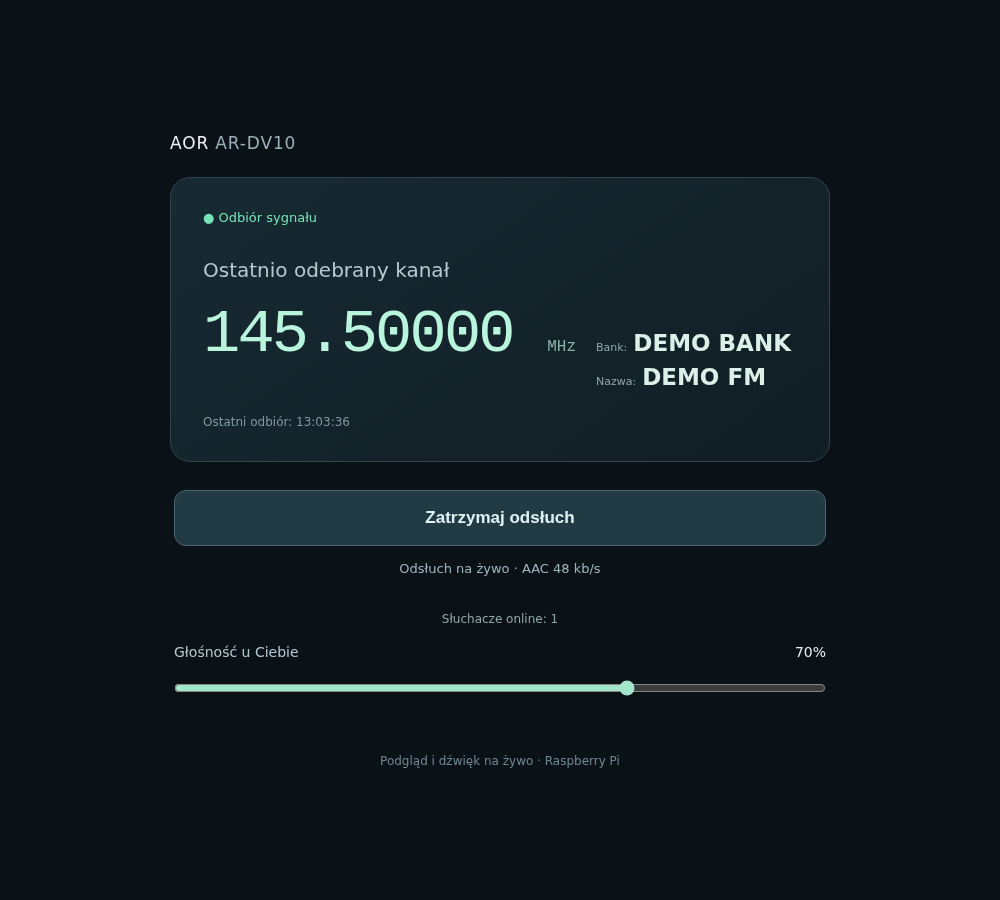

# AOR DV10 Raspberry Suite

Polski · [English](README.md)

Panel sterowania i osobna strona do odsłuchu odbiornika AOR AR-DV10 na Raspberry Pi.
Projekt powstał z wykorzystaniem [roxio/AOR-AR-DV10-Suite](https://github.com/roxio/AOR-AR-DV10-Suite) i zachowuje oznaczenia autorów oryginału. Repozytorium korzysta z istniejącej licencji GPL-3.0 w pliku [LICENSE](LICENSE), a oryginalna licencja MIT i informacja o prawach autorskich są zachowane w [LICENSE.upstream-MIT](LICENSE.upstream-MIT).
Dokumentacja oryginalnej biblioteki znajduje się w [docs/UPSTREAM_README.pl.md](docs/UPSTREAM_README.pl.md).

## Funkcje

- Port **8080**: sterowanie radiem, nazwa kanału obok częstotliwości oraz wgrywanie CSV z przeglądarki.
- Port **80**: podgląd i odsłuch bez komend sterujących. Ostatnio odebrana częstotliwość i nazwa pozostają widoczne podczas skanowania.
- Wspólny dźwięk **AAC-LC, 48 kb/s, mono, 24 kHz**, przechwytywany z wejścia ALSA za pomocą FFmpeg.
- Oryginalny eksport **AR-DV10 Connect / DEPMICRO-BACKUP** lub prosty CSV `frequency_mhz;name`.
- Automatyczny odczyt zmienionego CSV, walidacja przesyłanych plików, zapis atomowy i kopia poprzedniej bazy nazw.
- Pełny odczyt pamięci radia **co niedzielę o 04:00, Europe/Warsaw**: 40 banków i 2000 pozycji, z ochroną przed nadpisaniem pliku ręcznie zmienionego w czasie pobierania.
- **Tylko na porcie 80:** pionowy układ banku i kanału, małe etykiety **Bank:** / **Nazwa:** oraz licznik aktywnych odsłuchów. Port 8080 zachowuje układ panelu sterowania.

## Zrzuty ekranów

Zrzuty przedstawiają rzeczywisty interfejs uruchomiony z symulatorem i przykładowymi kanałami. Nie zawierają prywatnej bazy częstotliwości.

### Podgląd i odsłuch — port 80



### Panel sterowania — port 8080


## Instalacja

Wymagane: Linux/Raspberry Pi OS, Python 3.10 lub nowszy, odbiornik po USB i osobne wejście audio dostępne w ALSA. Wdrożenia sprawdzono z odbiornikami AR-DV10 i AR-DV1 na Raspberry Pi 3 z Python 3.13. Przy AR-DV1 należy jawnie wskazać port szeregowy.

Po sklonowaniu tego repozytorium przejdź do jego katalogu:

```bash
sudo apt update
sudo apt install python3-venv ffmpeg
python3 -m venv .venv
.venv/bin/python -m pip install -e '.[web]'
```

Instalacja edytowalna (`-e`) jest wymagana przez integrację panelu ze źródłami `raspberry-viewer/`. Użytkownik uruchamiający proces musi mieć dostęp do portu szeregowego i wejścia audio.

### Uruchomienie ręczne

W pierwszym terminalu uruchom panel sterowania. Parametr `--serial-port` można pominąć dla automatycznego wykrywania:

```bash
.venv/bin/dv10-web --host 0.0.0.0 --port 8080
```

W drugim terminalu uruchom podgląd na nieuprzywilejowanym porcie 8081:

```bash
AOR_VIEWER_HOST=0.0.0.0 PORT=8081 .venv/bin/python raspberry-viewer/server.py
```

Otwórz `http://ADRES_RASPBERRY:8080/` i w sekcji **Nazwy kanałów w podglądzie** wgraj plik CSV. Otwórz `http://ADRES_RASPBERRY:8081/` i kliknij **Słuchaj na żywo**.

### Start automatyczny: podgląd 80, sterowanie 8080

```bash
sudo .venv/bin/python deploy/install-systemd.py --user pi
```

Opcjonalnie dodaj `--serial-port /dev/serial/by-id/TWOJE_URZADZENIE`. Instalator zapisuje jednostki `aor-dv10.service` i `aor-viewer.service`, zachowuje kopie istniejących jednostek i uruchamia obie usługi. Włącza również cotygodniowy timer i rozpoczyna pierwszy odczyt pamięci w tle. Dodaj `--no-weekly-sync`, jeżeli chcesz samodzielnie zarządzać CSV. Opcja `--check`, bez sudo, sprawdza jednostki bez zmieniania usług. Użytkownik wskazany przez `--user` musi mieć dostęp do całego katalogu projektu i środowiska `.venv`.

Jeśli korzystasz ze starszej usługi podglądu uruchamianej jako usługa użytkownika, wyłącz ją wcześniej: `systemctl --user disable --now aor-viewer.service`. Porty 80 i 8080 muszą być dostępne dla nowych usług.

```bash
systemctl status aor-dv10.service aor-viewer.service
journalctl -u aor-dv10.service -u aor-viewer.service -n 50
```

Podgląd na porcie 80 blokuje przesyłanie komend. Panel sterowania na 8080 pozostaje dostępny w tej samej sieci i nie ma uwierzytelniania. Udostępniaj go w zaufanej sieci; dostęp zdalny organizuj przez VPN lub odpowiednio zabezpieczony serwer pośredniczący.

## Konfiguracja

| Zmienna | Domyślnie | Znaczenie |
| --- | --- | --- |
| `AOR_VIEWER_DATA_DIR` | `~/.local/share/aor-dv10` | Wspólny katalog danych obu procesów; zawiera `channels.csv` i `backups/`. |
| `AOR_AUDIO_DEVICE` | `plughw:CARD=Device,DEV=0` | Wejście ALSA używane przez panel sterowania. |
| `AOR_CONTROL_HOST` | `127.0.0.1` | Adres panelu, z którym łączy się podgląd. |
| `UPSTREAM_PORT` | `8080` | Port panelu sterowania. |
| `AOR_VIEWER_HOST` | `127.0.0.1` | Adres nasłuchiwania podglądu. |
| `PORT` | `8081` | Port podglądu przy uruchomieniu ręcznym; jednostka systemd ustawia 80. |

Przy ręcznym uruchamianiu oba procesy powinny używać tego samego `AOR_VIEWER_DATA_DIR`. Przy usługach systemd wspólne ustawienia można dodać w pliku `/etc/aor-dv10.env`, np. `AOR_AUDIO_DEVICE=plughw:CARD=Device,DEV=0`.

Przykłady CSV są w `examples/`. Eksport w oryginalnym formacie jest czytany bez konwersji; nazwy o tej samej częstotliwości są łączone. Limit przesyłanego pliku wynosi 1 MB; wymagane kodowanie to UTF-8 (opcjonalnie z BOM).

## Ostatni odebrany kanał

Podgląd zapamiętuje kanał, gdy radio zgłasza otwartą blokadę szumów (`squelch_open`). Kolejne częstotliwości skanowania nie zastępują zapamiętanego odbioru. Przed pierwszym odebranym sygnałem wyświetla się oczekiwanie. Stan jest przechowywany w pamięci usługi; restart usługi go zeruje. Dane są odpytywane przy otwartym podglądzie mniej więcej co sekundę, więc bardzo krótkie transmisje mogą zostać pominięte.

## Cotygodniowy odczyt pamięci radia

Instalator systemd włącza `aor-radio-channels-sync.timer`: **niedziela o 04:00, Europe/Warsaw**. `Persistent=true` pozwala nadrobić pominięty termin po uruchomieniu urządzenia. Skrypt czeka do 90 sekund na gotowość panelu sterowania.

Wszystkie 40 banków jest odczytywanych przez działający panel, z wykorzystaniem jego połączenia szeregowego. Dopiero poprawny eksport wszystkich 2000 pozycji zastępuje `channels.csv`; poprzedni plik trafia do kopii. Błąd, niepełny odczyt, pusta lista lub ręczna podmiana CSV w trakcie pobierania pozostawiają dotychczasowy plik. Oba panele korzystają z tej samej bazy. Odczyt nie programuje kanałów w odbiorniku.

```bash
systemctl list-timers aor-radio-channels-sync.timer
sudo systemctl start aor-radio-channels-sync.service
journalctl -u aor-radio-channels-sync.service -n 30
```

Przy instalacji ręcznej bez systemd uruchom `.venv/bin/python raspberry-viewer/sync_radio_channels.py`, ustawiając wspólny dla obu paneli `AOR_VIEWER_DATA_DIR`. Jeśli panel nie działa pod domyślnym `http://127.0.0.1:8080`, ustaw `AOR_CONTROL_URL`. Opcja `--check-only` pobiera i sprawdza pamięć bez zastępowania CSV. Informacja o ostatnim udanym odczycie jest zapisywana w `radio-channel-sync-state.json` w katalogu danych.

Termin można zmienić argumentem instalatora `--sync-calendar`. Logi i kopie pozostają na Raspberry Pi.

## Nazwa banku, kanału i licznik słuchaczy

Oryginalny eksport Connect zawiera nazwę banku (`MB`) i nazwę kanału (`MC`). Na stronie odsłuchowej bank jest u góry, a kanał pod nim; poprzedzają je małe etykiety `Bank:` i `Nazwa:`. Kanał bez własnej nazwy pokazuje sam bank. Jeśli częstotliwość występuje w kilku bankach, wyświetlane są wszystkie pasujące opisy.

Licznik `Słuchacze online` **na porcie 80** zlicza aktywne połączenia odsłuchowe AAC obsługiwane przez tę stronę, także przez przekierowujący do niej serwer HTTPS. Nie liczy unikalnych osób ani samego otwarcia strony: dwie grające karty to dwa odsłuchy. Odtwarzanie bezpośrednio z panelu sterowania nie jest wliczane. Na porcie 8080 nie dodano tego licznika ani małych etykiet.

## Uruchomienie skanowania banku pamięci

Na porcie **8080** rozwiń **Eksperymentalne · Telemetria · Konsola surowa i kolejka poleceń** i wyślij:

```text
raw MS 11
```

Uruchomi to skanowanie banku pamięci 11. Dla innego banku podaj jego dwucyfrowy numer. Bank musi zawierać zapisane kanały. Przycisk **VFO A** przełącza z powrotem do VFO i zatrzymuje skanowanie. Port 80 służy do podglądu i nie uruchamia skanowania. Komendę `MS` opisuje [lista poleceń AOR, sekcja Memory Scan](https://www.aorja.com/support/manuals/AR-DV1_COMMAND_LIST.pdf), a [zestawienie DV10/DV1](https://www.aorja.com/support/manuals/AR-DV10_AND_AR-DV1_COMMAND_LIST_SUMMARY.pdf) potwierdza obsługę obu modeli. Narzędzie **Start kolejki** uruchamia przeszukiwanie zakresów, czyli inną funkcję niż skanowanie zapisanych kanałów pamięci.

## Testy

```bash
.venv/bin/python -m unittest discover -s tests -p 'test_raspberry_viewer.py' -v
.venv/bin/python -m unittest discover -s tests -p 'test_radio_sync.py' -v
```

Oryginalne testy projektu wymagają zależności deweloperskich z `.[dev]`. Testy nowego podglądu używają danych syntetycznych i nie sterują fizycznym radiem.

Repozytorium nie zawiera prywatnej bazy kanałów, kluczy SSH ani kopii danych z działającego Raspberry Pi.
