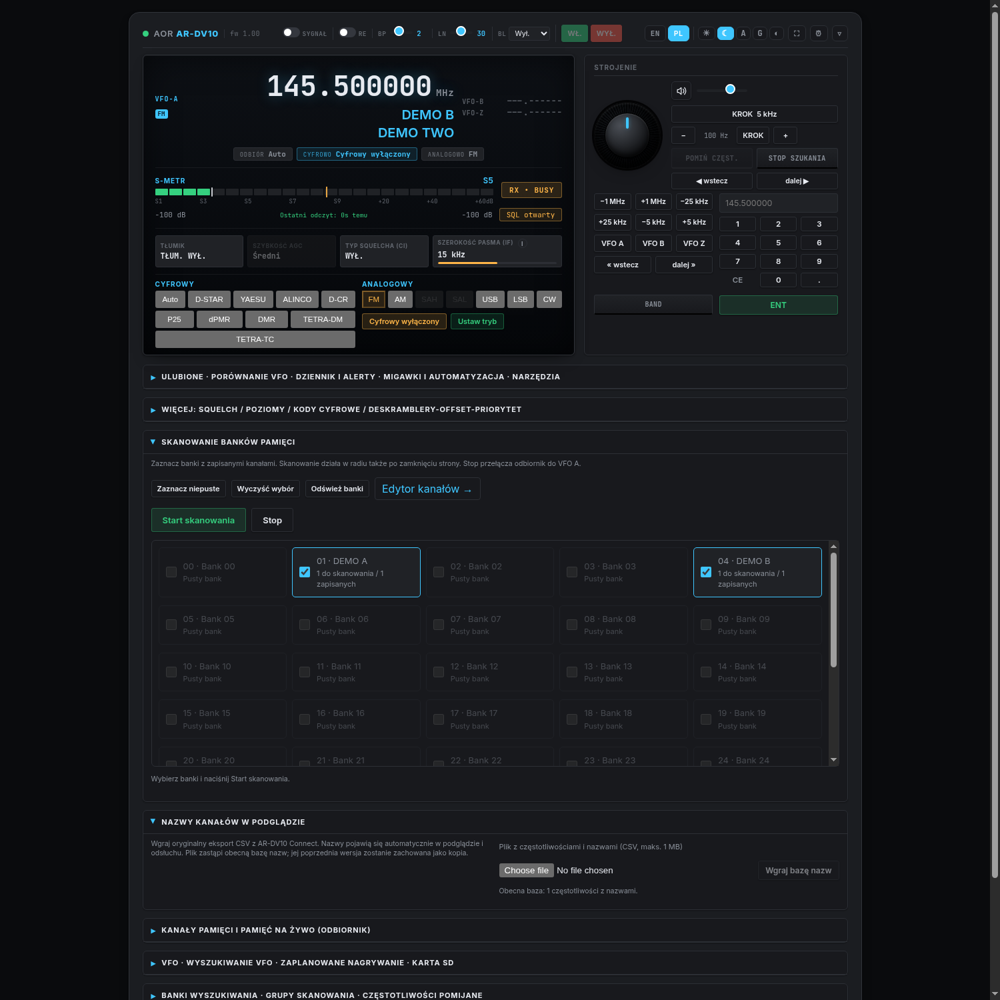
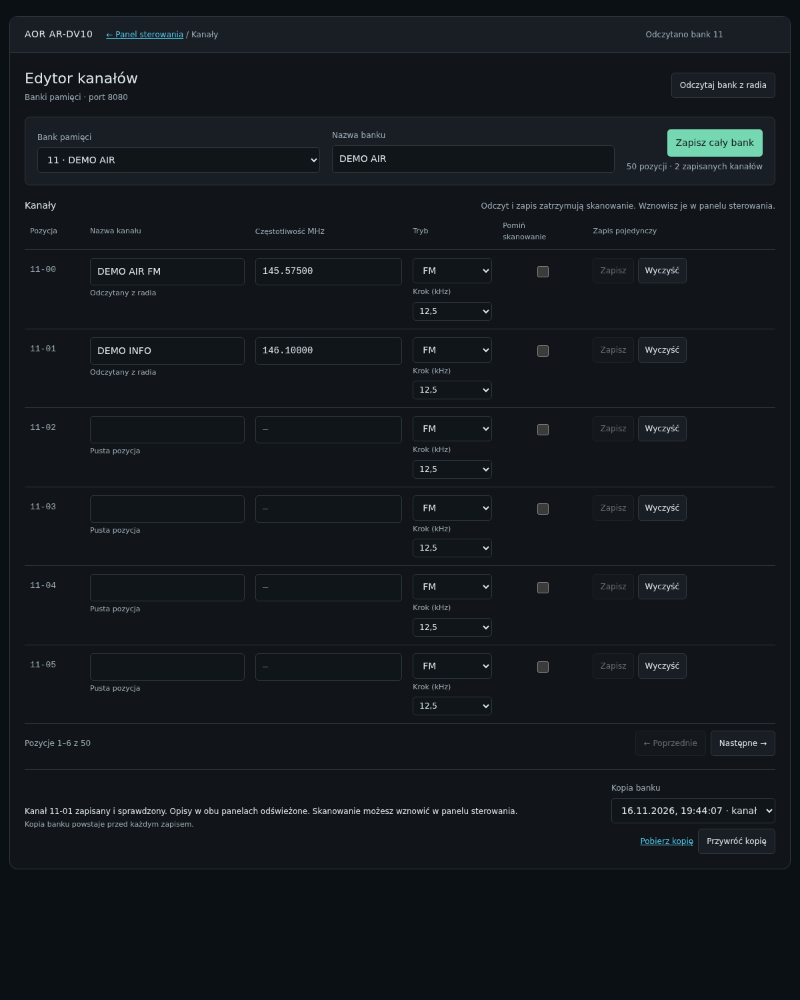

# AOR DV10 Raspberry Suite

Polski · [English](README.md)

Panel sterowania, edytor kanałów i osobna strona do odsłuchu odbiorników AOR AR-DV10 i AR-DV1 na Raspberry Pi.
Projekt powstał z wykorzystaniem [roxio/AOR-AR-DV10-Suite](https://github.com/roxio/AOR-AR-DV10-Suite) i zachowuje oznaczenia autorów oryginału. Repozytorium korzysta z istniejącej licencji GPL-3.0 w pliku [LICENSE](LICENSE), a oryginalna licencja MIT i informacja o prawach autorskich są zachowane w [LICENSE.upstream-MIT](LICENSE.upstream-MIT).
Dokumentacja oryginalnej biblioteki znajduje się w [docs/UPSTREAM_README.pl.md](docs/UPSTREAM_README.pl.md).

## Funkcje

- **Edytor kanałów na porcie 8080:** zapis pojedynczego kanału lub całego banku, trwałe kopie przed zapisem, odczyt kontrolny oraz pobieranie i przywracanie kopii.

- **Właściwy bank i kanał na obu portach:** przy powtarzających się częstotliwościach wyświetlana jest wyłącznie aktualna pozycja pamięci radia, bez łączenia opisów.
- Nazwa banku i kanału w **tytule karty przeglądarki** na obu portach: na porcie 80 pozostaje ostatnio odebrany kanał, a na 8080 tytuł podąża za bieżącą częstotliwością. Gdy brakuje opisu, pokazuje częstotliwość.
- Port **8080**: sterowanie radiem, wybór banków z nazwami i **Start/Stop skanowania**, opisy kanałów oraz wgrywanie CSV z przeglądarki.
- Port **80**: podgląd i odsłuch bez komend sterujących. Ostatnio odebrana częstotliwość i nazwa pozostają widoczne podczas skanowania.
- Wspólny dźwięk **AAC-LC, 48 kb/s, mono, 24 kHz**, przechwytywany z wejścia ALSA za pomocą FFmpeg.
- Oryginalny eksport **AR-DV10 Connect / DEPMICRO-BACKUP** lub prosty CSV `frequency_mhz;name`.
- Automatyczny odczyt zmienionego CSV, walidacja przesyłanych plików, zapis atomowy i kopia poprzedniej bazy nazw.
- Pełny odczyt pamięci radia **co niedzielę o 04:00, Europe/Warsaw**: 40 banków i 2000 pozycji, z ochroną przed nadpisaniem pliku ręcznie zmienionego w czasie pobierania.
- **Tylko na porcie 80:** pionowy układ banku i kanału, małe etykiety **Bank:** / **Nazwa:** oraz licznik aktywnych odsłuchów. Port 8080 zachowuje układ panelu sterowania.

## Zrzuty ekranów

Zrzuty przedstawiają rzeczywisty interfejs uruchomiony z symulatorem i przykładowymi kanałami. Nie zawierają prywatnej bazy częstotliwości.

Nowe zrzuty obu paneli pokazują **145.500 MHz zapisaną w dwóch bankach pamięci**: `01 / DEMO A / DEMO ONE` i `04 / DEMO B / DEMO TWO`. Panel sterowania pokazuje bieżącą pozycję w banku 04. Podgląd zachowuje tę samą parę banku i kanału po wznowieniu skanowania przez bank 01 na tej samej częstotliwości. W każdym widoku jest jeden bank i jeden kanał.

### Podgląd i odsłuch — port 80


### Panel sterowania — port 8080



## Instalacja

Wymagane: Linux/Raspberry Pi OS, Python 3.10 lub nowszy, odbiornik po USB i osobne wejście audio dostępne w ALSA. Wdrożenia sprawdzono z odbiornikami AR-DV10 i AR-DV1 na Raspberry Pi 3 z Python 3.13. Przy AR-DV1 należy jawnie wskazać port szeregowy.

Po sklonowaniu tego repozytorium przejdź do jego katalogu:

```bash
sudo apt update
sudo apt install python3-venv ffmpeg
python3 -m venv .venv
.venv/bin/python -m pip install -e '.[web]'
```

Instalacja edytowalna (`-e`) jest wymagana przez integrację panelu ze źródłami `raspberry-viewer/`. Użytkownik uruchamiający proces musi mieć dostęp do portu szeregowego i wejścia audio.

### Uruchomienie ręczne

W pierwszym terminalu uruchom panel sterowania. Parametr `--serial-port` można pominąć dla automatycznego wykrywania:

```bash
.venv/bin/dv10-web --host 0.0.0.0 --port 8080
```

W drugim terminalu uruchom podgląd na nieuprzywilejowanym porcie 8081:

```bash
AOR_VIEWER_HOST=0.0.0.0 PORT=8081 .venv/bin/python raspberry-viewer/server.py
```

Otwórz `http://ADRES_RASPBERRY:8080/` i w sekcji **Nazwy kanałów w podglądzie** wgraj plik CSV. Otwórz `http://ADRES_RASPBERRY:8081/` i kliknij **Słuchaj na żywo**.

### Start automatyczny: podgląd 80, sterowanie 8080

```bash
sudo .venv/bin/python deploy/install-systemd.py --user pi
```

Opcjonalnie dodaj `--serial-port /dev/serial/by-id/TWOJE_URZADZENIE`. Instalator zapisuje jednostki `aor-dv10.service` i `aor-viewer.service`, zachowuje kopie istniejących jednostek i uruchamia obie usługi. Włącza również cotygodniowy timer i rozpoczyna pierwszy odczyt pamięci w tle. Dodaj `--no-weekly-sync`, jeżeli chcesz samodzielnie zarządzać CSV. Opcja `--check`, bez sudo, sprawdza jednostki bez zmieniania usług. Użytkownik wskazany przez `--user` musi mieć dostęp do całego katalogu projektu i środowiska `.venv`.

Jeśli korzystasz ze starszej usługi podglądu uruchamianej jako usługa użytkownika, wyłącz ją wcześniej: `systemctl --user disable --now aor-viewer.service`. Porty 80 i 8080 muszą być dostępne dla nowych usług.

```bash
systemctl status aor-dv10.service aor-viewer.service
journalctl -u aor-dv10.service -u aor-viewer.service -n 50
```

Podgląd na porcie 80 blokuje przesyłanie komend. Panel sterowania na 8080 pozostaje dostępny w tej samej sieci i nie ma uwierzytelniania. Udostępniaj go w zaufanej sieci; dostęp zdalny organizuj przez VPN lub odpowiednio zabezpieczony serwer pośredniczący.

## Konfiguracja

| Zmienna | Domyślnie | Znaczenie |
| --- | --- | --- |
| `AOR_VIEWER_DATA_DIR` | `~/.local/share/aor-dv10` | Wspólny katalog danych obu procesów; zawiera `channels.csv` i `backups/`. |
| `AOR_AUDIO_DEVICE` | `plughw:CARD=Device,DEV=0` | Wejście ALSA używane przez panel sterowania. |
| `AOR_CONTROL_HOST` | `127.0.0.1` | Adres panelu, z którym łączy się podgląd. |
| `UPSTREAM_PORT` | `8080` | Port panelu sterowania. |
| `AOR_VIEWER_HOST` | `127.0.0.1` | Adres nasłuchiwania podglądu. |
| `PORT` | `8081` | Port podglądu przy uruchomieniu ręcznym; jednostka systemd ustawia 80. |

Przy ręcznym uruchamianiu oba procesy powinny używać tego samego `AOR_VIEWER_DATA_DIR`. Przy usługach systemd wspólne ustawienia można dodać w pliku `/etc/aor-dv10.env`, np. `AOR_AUDIO_DEVICE=plughw:CARD=Device,DEV=0`.

Przykłady CSV są w `examples/`. Eksport w oryginalnym formacie jest czytany bez konwersji; bank i kanał są dobierane według pozycji pamięci zgłoszonej przez radio. Powtarzające się częstotliwości nie powodują łączenia opisów. Prosty CSV z częstotliwością i nazwą nadal można wgrać, ale nie zawiera on informacji o bankach. Limit przesyłanego pliku wynosi 1 MB; wymagane kodowanie to UTF-8 (opcjonalnie z BOM).

## Ostatni odebrany kanał

Podgląd zapisuje razem bank, pozycję kanału, częstotliwość i nazwę, gdy radio zgłasza otwartą blokadę szumów. Po wznowieniu skanowania port 80 zachowuje ten konkretny odbiór, nawet jeśli ta sama częstotliwość znajduje się w innych bankach. Port 8080 pokazuje bieżącą pozycję radia. Przed pierwszym odebranym sygnałem podgląd pokazuje oczekiwanie.

Usługa sterowania odbiera raporty mniej więcej co 500 ms i zapamiętuje ostatni odbiór niezależnie od odpytywania przeglądarki. Strona odświeża dane mniej więcej co sekundę. Bardzo krótkie transmisje pomiędzy raportami mogą zostać pominięte. Historia pozostaje w pamięci; restart usługi sterowania ją zeruje. Po restarcie samego podglądu ostatni odbiór może zostać odtworzony z nadal działającej usługi sterowania.

## Cotygodniowy odczyt pamięci radia

Instalator systemd włącza `aor-radio-channels-sync.timer`: **niedziela o 04:00, Europe/Warsaw**. `Persistent=true` pozwala nadrobić pominięty termin po uruchomieniu urządzenia. Skrypt czeka do 90 sekund na gotowość panelu sterowania.

Wszystkie 40 banków jest odczytywanych przez działający panel, z wykorzystaniem jego połączenia szeregowego. Dopiero poprawny eksport wszystkich 2000 pozycji zastępuje `channels.csv`; poprzedni plik trafia do kopii. Błąd, niepełny odczyt, pusta lista lub ręczna podmiana CSV w trakcie pobierania pozostawiają dotychczasowy plik. Oba panele korzystają z tej samej bazy. Odczyt nie programuje kanałów w odbiorniku.

```bash
systemctl list-timers aor-radio-channels-sync.timer
sudo systemctl start aor-radio-channels-sync.service
journalctl -u aor-radio-channels-sync.service -n 30
```

Przy instalacji ręcznej bez systemd uruchom `.venv/bin/python raspberry-viewer/sync_radio_channels.py`, ustawiając wspólny dla obu paneli `AOR_VIEWER_DATA_DIR`. Jeśli panel nie działa pod domyślnym `http://127.0.0.1:8080`, ustaw `AOR_CONTROL_URL`. Opcja `--check-only` pobiera i sprawdza pamięć bez zastępowania CSV. Informacja o ostatnim udanym odczycie jest zapisywana w `radio-channel-sync-state.json` w katalogu danych.

Termin można zmienić argumentem instalatora `--sync-calendar`. Logi i kopie pozostają na Raspberry Pi.

## Nazwa banku, kanału i licznik słuchaczy

Oryginalny eksport Connect zawiera nazwę banku (`MB`) i nazwę kanału (`MC`). Na stronie odsłuchowej bank jest u góry, a kanał pod nim; poprzedzają je małe etykiety `Bank:` i `Nazwa:`. Kanał bez własnej nazwy pokazuje sam bank. Jeśli częstotliwość występuje w kilku bankach, **wyświetlany jest tylko aktualny bank i kanał**. Raport radia w trybie pamięci zawiera razem numer banku i pozycji, częstotliwość, nazwę kanału oraz stan odbioru. Nazwa banku pochodzi z odpowiadającego mu rekordu `MB`. Używana jest bieżąca nazwa kanału z radia; jeśli jest pusta, nazwa może pochodzić z dokładnie tej pozycji `MC`, pod warunkiem zgodności częstotliwości.

Przykładowo dwa banki mogą zawierać 145.500 MHz z nazwami `DEMO ONE` i `DEMO TWO`. Przy odbiorze drugiej pozycji widoczny jest tylko jej bank i `DEMO TWO`; port 80 zachowuje tę parę po wznowieniu skanowania. Tytuł karty przeglądarki używa tego samego opisu. W trybie VFO/przeszukiwania albo przy braku aktualnego raportu nazwa banku nie jest zgadywana na podstawie częstotliwości.

Licznik `Słuchacze online` **na porcie 80** zlicza aktywne połączenia odsłuchowe AAC obsługiwane przez tę stronę, także przez przekierowujący do niej serwer HTTPS. Nie liczy unikalnych osób ani samego otwarcia strony: dwie grające karty to dwa odsłuchy. Odtwarzanie bezpośrednio z panelu sterowania nie jest wliczane. Na porcie 8080 nie dodano tego licznika ani małych etykiet.

Na porcie 8080 bank i kanał są wyświetlane w osobnych wierszach, bez małych etykiet i licznika odsłuchów.

## Skanowanie banków z panelu sterowania

Na **porcie 8080** otwórz sekcję **Skanowanie banków pamięci**:

1. Zaznacz jeden lub kilka banków. Lista pokazuje numer, nazwę i liczbę kanałów dostępnych do skanowania. Puste banki oraz banki zawierające wyłącznie pomijane kanały są nieaktywne.
2. Kliknij **Start skanowania**. Radio skanuje wybrane banki swoim skanerem pamięci; skanowanie trwa również po zamknięciu przeglądarki.
3. Kliknij **Stop**, aby zatrzymać skanowanie i przełączyć odbiornik do **VFO A**.

**Zaznacz niepuste** wybiera wszystkie dostępne banki, a **Wyczyść wybór** usuwa zaznaczenia. **Odśwież banki** ponownie wczytuje listę ze wspólnego pliku CSV. Wybór banków jest zapamiętywany w bieżącej przeglądarce. Potrzebny jest oryginalny eksport **Connect / DEPMICRO-BACKUP z rekordami MB i MC** albo wcześniejszy odczyt pamięci radia skryptem synchronizacji. Prosty CSV z częstotliwością i nazwą nie zawiera struktury banków. Wgranie CSV aktualizuje opisy i wybór banków; nie programuje pamięci odbiornika.

Sekcja zajmuje pełną szerokość panelu, lista banków ma przewijanie, a Start i Stop znajdują się nad nią. Komunikat po kliknięciu potwierdza wykonanie polecenia; nie jest ciągłym odczytem trybu pracy radia. Sterowanie skanowaniem jest dostępne tylko na porcie 8080. Podgląd na porcie 80 nie uruchamia ani nie zatrzymuje skanowania.

Sprawdzone na rzeczywistych odbiornikach **AR-DV10 i AR-DV1**. Funkcja wykorzystuje natywne polecenia MR/BK/MS i wykonuje je bez nakładania na inne polecenia radia. Stop przełącza do VFO A, więc może zmienić aktualnie słyszaną częstotliwość. Narzędzie **Start kolejki** służy osobno do przeszukiwania zakresów.

## Edytor kanałów — port 8080

W panelu sterowania kliknij **Edytor kanałów** albo otwórz `http://ADRES_RASPBERRY:8080/memory-editor`.

1. Wybierz bank i kliknij **Odczytaj bank z radia**. Radio przejdzie do **VFO A**, zatrzymując skanowanie. Dane zostaną dopuszczone do edycji i wykonania kopii dopiero po dwóch zgodnych odczytach: DV10 potrafi zwracać niespójne dane pamięci podczas skanowania.
2. Edytuj nazwy, częstotliwości w MHz, tryby odbioru, kroki strojenia i oznaczenia pomijania podczas skanowania. Nazwy w radiu mogą mieć do 12 znaków ASCII, bez polskich liter. Chronione banki i kanały pozostają tylko do odczytu.
3. **Zapisz** w wierszu zapisuje pojedynczy kanał, a **Zapisz cały bank** synchronizuje wszystkie 50 pozycji i nazwę banku. Przy zapisie banku **puste pozycje usuwają odpowiadające im kanały z radia**. Zapisywane są tylko zmienione rekordy, po czym cały bank jest sprawdzany odczytem.
4. Przed każdym zapisem powstaje trwała kopia banku. Poniżej tabeli możesz wybrać kopię, pobrać ją albo przywrócić. Przywracanie również tworzy nową kopię bieżącej zawartości przed jej zastąpieniem.

Zapis jest blokowany, jeśli pamięć banku zmieniła się od jego odczytania. Operacja działa w tle, pokazuje postęp i może zostać przerwana pomiędzy kanałami. Wcześniej zapisane pozycje pozostają w radiu, a niezapisane zmiany pozostają w otwartym edytorze. Restart usługi nie wznawia automatycznie przerwanego zapisu. Po edycji uruchom skanowanie ponownie w panelu sterowania.

Kopie, stan przed zapisem i po nim oraz wyniki operacji pozostają w `AOR_VIEWER_DATA_DIR/backups/memory-editor/`. Zawierają prywatne dane odbiornika i nie trafiają do repozytorium. Gdy wspólny CSV jest oryginalnym eksportem Connect, poprawnie sprawdzony zapis odświeża opisy wybranego banku w obu panelach i zachowuje pozostałe banki. Prosty CSV z częstotliwością i nazwą wymaga pełnego odczytu pamięci radia, aby uzyskać strukturę banków.

Odbiorniki potrafią buforować zapis pamięci. Do sprawdzenia końcowego stanu edytor potrzebuje **drugiego niechronionego banku z co najmniej jednym kanałem**. Ponowny zapis jego niezmienionych danych opróżnia bufor; ten bank również trafia do kopii i jest sprawdzany pod kątem niezmienionej zawartości. Bez odpowiedniego banku zapis jest blokowany przed zmianą pamięci. Port 80 nie udostępnia edytora.

### Edytor kanałów



## Testy

```bash
.venv/bin/python -m unittest discover -s tests -p 'test_raspberry_viewer.py' -v
.venv/bin/python -m unittest discover -s tests -p 'test_radio_sync.py' -v
.venv/bin/python -m unittest discover -s tests -p 'test_memory_scan.py' -v
.venv/bin/python -m unittest discover -s tests -p 'test_memory_editor.py' -v
.venv/bin/python -m unittest discover -s tests -p 'test_receiver_identity.py' -v
```

Oryginalne testy projektu wymagają zależności deweloperskich z `.[dev]`. Testy nowego podglądu używają danych syntetycznych i nie sterują fizycznym radiem.

Repozytorium nie zawiera prywatnej bazy kanałów, kluczy SSH ani kopii danych z działającego Raspberry Pi.

Opcjonalne testy JavaScript (Node.js): `node --test tests/test_tab_titles.cjs tests/test_receiver_labels.cjs`.
